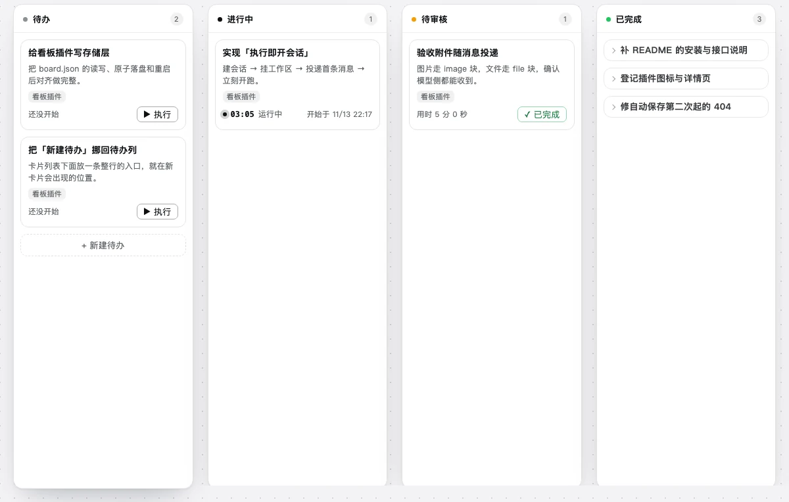
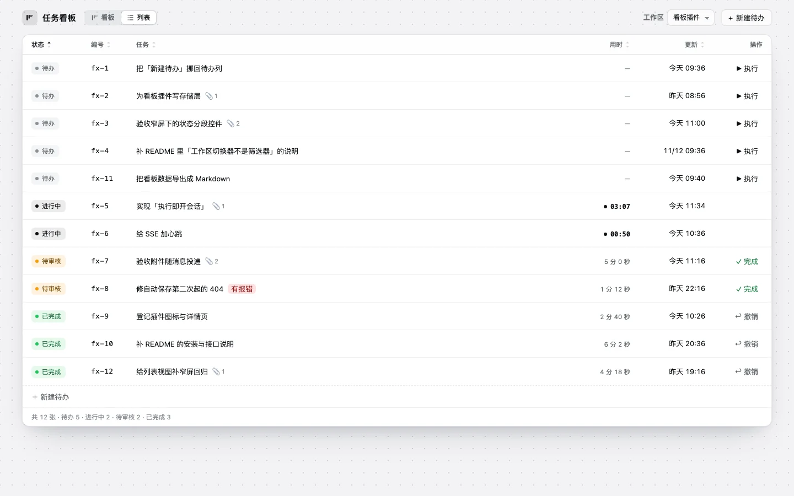

# 任务看板 · dsh-kanban-fx

**想法进看板，点执行就开跑。**

[DeepSeek Harness](https://github.com/deepseek-ai/deepseek-harness)（DSH）的 Web 插件。把要做的事记成一张卡片，
点「执行」就直接在对应工作区开会话、把卡片内容投进去开跑；跑完、报错、暂停，状态都挂在卡片上，
回看板就知道做到哪了。

[](CHANGELOG.md)
[](LICENSE)
[](https://github.com/deepseek-ai/deepseek-harness)

[官网](https://xianglifei.github.io/dsh-kanban-fx/) · [安装](#安装) · [常见问题](#常见问题) · [更新日志](CHANGELOG.md)



## 它解决什么

- **想法不丢。** 手上正忙着，脑子里冒出下一件事：先记成卡片，附件、工作区一起存下，回头再开。
- **不用搬运。** 不用复制标题、切到侧边栏、新建会话、粘贴、发送。卡片上点「执行」，会话已经在对应工作区里跑起来了。
- **不用盯。** 会话跑完自动进待审核，你点「完成」才进已完成；点错了还能撤销。进度不靠记忆，看板就是记忆。

## 安装

```sh
dsh plugin --profile desktop add github:xianglifei/dsh-kanban-fx
```

本地目录（开发）：

```sh
dsh plugin --profile desktop add link:/path/to/dsh-kanban-fx
```

装好后侧边栏出现「任务看板」。也可以在工作区行尾的「…」里选**「打开任务看板」**，直接落在那个工作区。
需要 DSH `^0.2.2-rc.1`。

## 三步上手

1. **记下来**：打开看板，点「+ 新建待办」（右上角，或待办列末尾）。标题可以留空，正文和附件按需填，所属工作区默认当前工作区；
停手 1.2 秒自动保存。

2. **点执行**：卡片上的「▶ 执行」，或新建时直接「▶ 立即执行」。插件会在卡片所属的工作区里建会话、把内容作为首条消息发进去并立刻开跑，
**不经过新建会话页**。手写的标题会作为首条消息第一行，正文原样跟在后面；标题留空时只发正文。

3. **收尾**：这一轮跑完，卡片自动进**待审核**。点卡片进会话看结果、继续说话（卡片当场回进行中），
满意就在看板、列表或会话标题栏点「✓ 完成」；完成后 toast 上可以撤销。

## 两个视图



- **看板**：四列 —— 待办 / 进行中 / 待审核 / 已完成。已完成列默认折成一行一条，点开才展开，一屏放得下更多历史。
- **列表**：一张平铺表格，状态是行内 pill，点表头排序，默认按状态（流程顺序）。窄屏自动收成任务 / 操作两列。
- 标题右侧切换视图；一次只显示**一个工作区**（这是工作区切换器，不是筛选器），进来的落点是上次看过的那个。
- 视图和排序记在浏览器本地，下次打开还是它。

界面细节、已完成折叠、窄屏规则、自动保存、标题派生、卡片编号等，见 [详细说明](docs/DETAIL.zh.md)。

## 状态规则

| 状态 | 什么时候 |
|---|---|
| **待办** | 卡片还没有会话 |
| **进行中** | 会话里有一轮还没结束（卡片上实时计时） |
| **待审核** | 这一轮结束了，等你验收（报错的卡片带「有报错」徽标） |
| **已完成** | 你点了完成；或「完成之后」配了收尾提示词，并且收尾轮正常结束 |
| **进行中（收尾中）** | 点过完成，收尾提示词已投递、这一轮还没结束；仍按进行中计数和排序 |

状态**跟着会话走**：在会话里继续说话就回进行中，跑完再回待审核；所以已完成不是终点。
v1 不支持拖拽或手动改状态。

## 完成之后

顶栏最右侧的齿轮进设置页：

- **什么都不做**（默认）：点完成立即移入已完成。
- **发送一条收尾提示词**：点完成先把提示词发进这张卡片的会话，卡片进入「收尾中」；这一轮**正常结束**才自动移入已完成，
  报错或被中止回待审核。提示词最多 4000 字符，必须非空，明文存在本机。

设置停手 600ms 自动保存，立刻生效，不用重启插件。撤销完成只撤销状态，不会撤回已经发出去的提示词。

## 数据

- 看板数据：`$DSH_HOME/dsh-kanban-fx/board.json`（默认 `~/.dsh/dsh-kanban-fx/board.json`）。卸载插件后数据仍留在磁盘上。
- 单张卡片正文上限 20 万字符，附件总量 24 MB（在 `cordis.patch.yml` 里改，重启生效）。
- 卡片编号 `fx-1`、`fx-2`……点一下复制，方便在会话里直接说「处理 fx-12」；编号只增不复用。

## 常见问题

**能拖拽或手动改状态吗？**
不能。状态完全由会话决定；你会看到的「收尾中」也仍是进行中的一种文案，不是第五种状态。

**标题留空会怎样？**
不填标题没关系：卡片会自动取正文第一个非空行（截到 42 字）作为卡片标题和会话名，但消息里不会重复发标题。

**会话被归档或删掉了？**
卡片上会出现「会话已归档」徽标，并多一个「▶ 重新执行」：在同一个工作区开新会话重跑，旧会话保持原样。

**升级后点保存报「接口不存在」？**
插件分 Host（`index.js`）和 Client（`client.js`）两半，刷新页面只换 Client。升级后到 DSH 里把「任务看板」禁用再启用（或重启 DSH），
才会加载新的 Host；看板数据不受影响。

**数据会上传吗？**
卡片、设置和附件引用只存在本机；执行时卡片内容会作为一条消息发进 DSH 会话，和正常对话一样。

## 更多

- [详细说明](docs/DETAIL.zh.md)（[English](docs/DETAIL.md)）：界面细节、自动保存、标题与首条消息、卡片编号、数据格式、Host 接口、执行 / 完成链路。
- [CHANGELOG.md](CHANGELOG.md)：每个版本改了什么、为什么。
- [官网](https://xianglifei.github.io/dsh-kanban-fx/)：功能、流程、深浅色与窄屏截图、安装和 FAQ。源码在 [`site/`](site/)，纯静态、无构建步骤。
- [AGENTS.md](AGENTS.md)：推送前必须同步 README 与 CHANGELOG 的约定。

## 开发

- `index.js`：Host 半（存储、HTTP、执行、完成两段式、状态机）。
- `client.js`：Client 半（侧边栏入口、看板、列表、新建 / 详情抽屉、设置页、会话标题栏）。
- 只依赖 Node 内置模块与 Host 侧 `ctx` 服务，不 import 任何 `@deepseek-ai/*` 包，**没有构建步骤**。
- 视觉沿用「点阵画布 + 浮起圆角卡」：颜色只走 `--dsw-alias-*` token，深浅色都要能看。

## 许可

[MIT](LICENSE)。欢迎 fork、改、提 PR。
