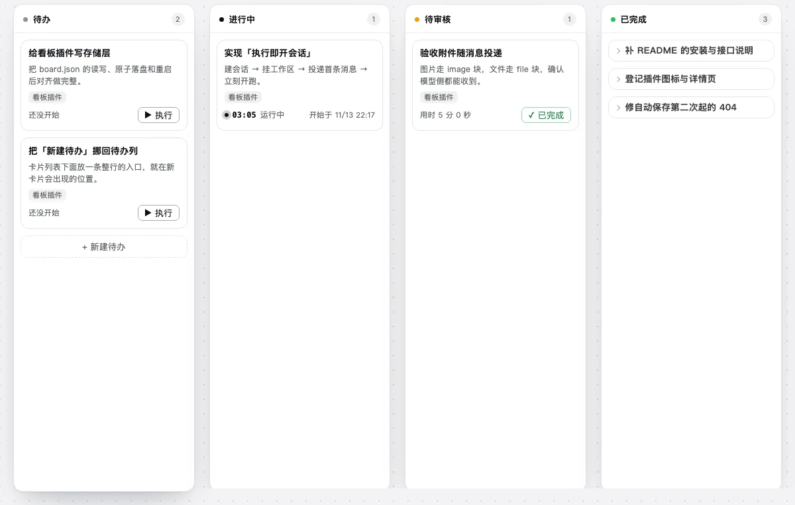
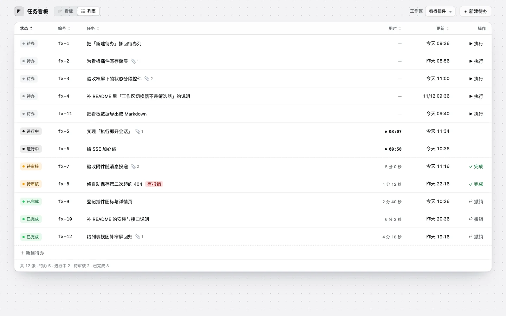

# 任务看板 · dsh-kanban-fx

**想法进看板，点执行就开跑。**

[DeepSeek Harness](https://github.com/deepseek-ai/deepseek-harness)（DSH）的 Web 插件。把要做的事记成一张卡片，
点「执行」就直接在对应工作区开会话、把卡片内容投进去开跑；跑完、报错、暂停，状态都挂在卡片上，
回看板就知道做到哪了。

[](CHANGELOG.md)
[](LICENSE)
[](https://github.com/deepseek-ai/deepseek-harness)

[官网](https://xianglifei.github.io/dsh-kanban-fx/) · [安装](#安装) · [常见问题](#常见问题) · [更新日志](CHANGELOG.md)



## 它解决什么

- **想法不丢。** 手上正忙着，脑子里冒出下一件事：先记成卡片，附件、工作区一起存下，回头再开。
- **不用搬运。** 不用复制标题、切到侧边栏、新建会话、粘贴、发送。卡片上点「执行」，会话已经在对应工作区里跑起来了。
- **不用盯。** 会话跑完自动进待审核，你点「完成」才进已完成；点错了还能撤销。助手中途问你一句时，卡片会亮起「等你回答」并排到最前。进度不靠记忆，看板就是记忆。

## 安装

```sh
dsh plugin --profile desktop add github:xianglifei/dsh-kanban-fx
```

本地目录（开发）：

```sh
dsh plugin --profile desktop add link:/path/to/dsh-kanban-fx
```

装好后侧边栏出现「任务看板」。也可以在工作区行尾的「…」里选**「打开任务看板」**，直接落在那个工作区。
需要 DSH `^0.2.2-rc.1`。

## 三步上手

1. **记下来**：打开看板，点「+ 新建待办」（右上角，或待办列末尾）。标题可以留空，正文和附件按需填，
所属工作区默认当前工作区（视图停在「全部工作区」时留空，要你先选一个才能保存）；停手 1.2 秒自动保存。

2. **点执行**：卡片上的「▶ 执行」，或新建时直接「▶ 立即执行」。插件会在卡片所属的工作区里建会话、把内容作为首条消息发进去并立刻开跑，
**不经过新建会话页**。手写的标题会作为首条消息第一行，正文原样跟在后面；标题留空时只发正文。

3. **收尾**：这一轮跑完，卡片自动进**待审核**。点卡片进会话看结果、继续说话（卡片当场回进行中），
满意就在看板、列表或会话标题栏点「✓ 完成」；完成后 toast 上可以撤销。

如果助手跑到一半用 `ask_user_question` 问你、或在等一次权限确认，这一轮还开着：卡片留在**进行中**，
但脚部换成琥珀点的「00:40 等你回答」（计时的是已等多久），并排到本列最前；列头计数也变琥珀色。回一句话它就在原地接着跑。

## 两个视图



- **看板**：四列 —— 待办 / 进行中 / 待审核 / 已完成。已完成列默认折成一行一条，点开才展开，一屏放得下更多历史。
  列被挤窄时卡片脚部不折行：进行中收起右端的「开始于 …」，待审核的「用时 3 分 20 秒」缩成「用时 3 分」、
  已完成的「完成于 11/14 09:20」缩成「完成于 11/14」；再放不下就把按钮整排挪到第二行、靠右。
  等你回答的卡片排在进行中列最前，列头那颗计数变成琥珀色（窄列只留数字，不再占一行文案）。
- **列表**：一张平铺表格，状态是行内 pill，点表头排序，默认按状态（流程顺序）。窄屏自动收成任务 / 操作两列。
- 标题右侧切换视图；右上角是**工作区切换器**：默认一次只看一个工作区，多个工作区时还能选**「全部工作区」**，
  把各仓库的卡片放在同一屏；进来的落点是上次看过的那个。
- 「全部工作区」里每张卡多一枚工作区小胶囊，点它就把看板收窄到那个工作区；其它视图不显示这枚胶囊——
  那里每张卡的工作区都一样，它恒等于顶栏那个选择，只是重复。胶囊那行位置一直留着（空着也不收），
  所以卡片大小不随 chip 增减变化，切换视图时整列不会跳。
- 视图和排序记在浏览器本地，下次打开还是它。

界面细节、已完成折叠、窄屏规则、自动保存、标题派生、卡片编号等，见 [详细说明](docs/DETAIL.zh.md)。

## 状态规则

| 状态 | 什么时候 |
|---|---|
| **待办** | 卡片还没有会话，或建了会话但一次都没真的跑起来（投递 / 建工作树失败，回到编辑改完重试） |
| **进行中** | 会话里有一轮还没结束（卡片上实时计时） |
| **待审核** | 这一轮结束了，等你验收（报错的卡片带「有报错」徽标） |
| **已完成** | 你点了完成；或「完成之后」配了收尾提示词，并且收尾轮正常结束 |
| **进行中（收尾中）** | 点过完成，收尾提示词已投递、这一轮还没结束；仍按进行中计数和排序 |
| **进行中（准备工作树）** | 第一次执行时正在新建分支与检出；建完才开始跑，仍按进行中计数和排序 |
| **进行中（等你回答）** | 助手问了一句 / 在等权限确认，这一轮还开着、球在你这边；回答后原地继续跑，等待时间不算任务用时 |

状态**跟着会话走**：在会话里继续说话就回进行中，跑完再回待审核；所以已完成不是终点。
v1 不支持拖拽或手动改状态。

## 完成之后

顶栏最右侧的齿轮进设置页：

- **什么都不做**（默认）：点完成立即移入已完成。
- **发送一条收尾提示词**：点完成先把提示词发进这张卡片的会话，卡片进入「收尾中」；这一轮**正常结束**才自动移入已完成，
  报错或被中止回待审核。提示词最多 4000 字符，必须非空，明文存在本机。

设置停手 600ms 自动保存，立刻生效，不用重启插件。撤销完成只撤销状态，不会撤回已经发出去的提示词。

## 独立工作树（可选，实验）

同一个仓库里并排跑两张卡时，两个会话会挤在同一个检出目录里改文件。想让每张卡在自己的分支上干活，
可以打开工作树——但**工作树不是看板自己实现的**，它调用的是 DSH 自带的服务：

1. **先开 DSH 的服务**：设置 → 插件 → 启用**「变更请求与工作树」**，按提示重启 DSH。看板会探测这个服务；
   没启用时，看板设置里的开关是灰的，并直接告诉你来这里开。
2. **再开看板的入口**：设置（齿轮）→ **实验功能** → 「在卡片上提供独立工作树」。
3. **按卡勾选**：新建 / 编辑卡片时多一个「在独立 worktree 中运行」，默认不勾；要不要隔离某张卡，由建卡的人决定。

勾上的卡片第一次执行时：先在仓库 `.agents/worktrees/` 下新建分支 `fx-<编号>-<标题片段>` 和检出目录，
把会话目录切过去，再投递内容；会话里会自动带上新的工作目录说明。源目录保持原样，未提交的改动**不会**带过去。

- 卡片上会出现一枚分支标（分支图标 + `fx-12-…`）；准备期间显示「准备工作树…」，失败会回到待办并保留原因，重试会换一个新分支名。
- 会话标题栏也会常驻一枚分支标（分支图标 + 分支名）：告诉你这一轮是在**哪**跑的，而不是项目目录。
  悬停给出分支、检出目录和「跑完在项目目录 `git merge <分支>` 合并回去；归档会删掉检出、分支保留」；
  标题栏窄到 620px 只剩图标（悬停与读屏仍然说得出分支名）。
- **已完成列会标出合并状态**：折叠行右侧一枚结论——`未合并`（琥珀）/ `已合并`（绿）/ `已合并，已删`（灰）/
  `无改动`（灰）/ `未提交`（琥珀，分支没提交但检出里还有改动）/ `未合并，已删`（红）。
  列头有未合并时补一句 `2 未合并`。展开后是完整分支标，悬停有分支名、提交数、并进哪个分支和可以照着敲的
  `git merge` 命令；末尾那枚小按钮复制合并 / 清理命令。
- 点「完成」时会先问一句：分支上还有没合并的提交（或检出里还有没提交的文件），就弹一张小卡，
  只有两个决定：**「继续完成」**（看板只记下这一轮没合回去）和 **「让会话合并」**（把合并交给会话）。
  右上角 ✕ 取消；会话已归档时「让会话合并」换成「复制命令」。会话标题栏则把「✓ 完成」就地变成确认文案，
  再点一次才标。待审核列不标色——那里的「未合并」是常态。
- 「让会话合并」把合并这件事交给这张卡片的会话：**直接发**一条带仓库、分支、检出和步骤的消息（不是预填草稿），
  由模型在沙箱里合并、跑测试、删分支，冲突它会停下来；发出去等于重开一轮，卡片回到进行中。
  卡片上的复制按钮可以直接拿到合并 / 清理命令，不想让模型动手时自己敲。
- 合并状态是**只读 Git 观测**：每仓库最多 60 秒查一次，只查待审核 / 已完成的卡片，不 fetch、不改仓库；
  关掉「设置 → 实验功能 → 在已完成列标出分支合并状态」后，卡片只显示分支名，插件也不再跑 Git。
  `squash` / `rebase` 合并可能认不出来，文案会写「没检测到合并」。
- 会话归档后点「重新执行」，新会话会回到同一份检出；目录已被删掉时给明确错误，可在会话里用 Forge 的「恢复工作树」。
- 工作树只在**第一条消息投递之前**建立；已经在项目目录跑过的卡片不会再被中途搬进新检出。
- 归档会话时，DSH 会回收干净且没人引用的检出（**分支保留**）；删卡片不等于删分支。
- 只从本地提交创建，不 fetch、不初始化子模块、不复制未提交文件；只读会话、仓库本身是 linked worktree 时不可用；
  大仓库检出可能要等一会儿，这版没有「取消」。
- 工作树相关的能力、清理和恢复都归 DSH：启用后，看板建的工作树也会出现在该会话的 Forge 面板里（diff / PR / 恢复都在那儿）。

> 指路要指对：插件页里叫**「变更请求与工作树」**，不是那个已被隐藏的「Git 工作树」。后者只有服务和模型工具，没有界面。
> 实测版本 DSH `0.2.2-rc.3`。

## 数据

- 看板数据：`$DSH_HOME/dsh-kanban-fx/board.json`（默认 `~/.dsh/dsh-kanban-fx/board.json`）。卸载插件后数据仍留在磁盘上。
  文件读不出来（损坏 / 结构不对）时，启动会先把它留档成 `board.json.corrupt-<时间戳>` 再从空看板起步，不会无提示地覆盖掉。
- 单张卡片正文上限 20 万字符，附件总量 24 MB（在 `cordis.patch.yml` 里改，重启生效）；编辑器里显示和校验的上限跟着这个配置走。
- 卡片编号 `fx-1`、`fx-2`……点一下复制，方便在会话里直接说「处理 fx-12」；编号只增不复用。

## 常见问题

**能拖拽或手动改状态吗？**
不能。状态完全由会话决定；你会看到的「收尾中」「准备工作树」「等你回答」也仍是进行中的一种文案，
不是第五种状态，也不占待审核那一列。

**标题留空会怎样？**
不填标题没关系：卡片会自动取正文第一个非空行（截到 42 字）作为卡片标题和会话名，但消息里不会重复发标题。

**会话被归档或删掉了？**
卡片上会出现「会话已归档」徽标，并多一个「▶ 重新执行」：在同一个工作区开新会话重跑，旧会话保持原样。

**已完成里的「未合并」是什么意思？**
那张卡是在独立 worktree 里跑的，分支上还有提交没被任何本地 / 远端分支包含（看板用只读 Git 查的）。
去项目目录 `git merge fx-12` 合完，它自己会变成「已合并」；`squash` / `rebase` 合并认不出来，展开卡片能看到分支名。
如果分支已经删了还是「未合并」，那是真丢了改动，去 `git reflog` 或 PR 里找找。

**设置里的工作树开关为什么是灰的？**
因为 DSH 没启用工作树服务。去「设置 → 插件」启用**「变更请求与工作树」**并重启 DSH。看板只做卡片上的入口，
不自己实现 worktree；服务不在时不会假装能用。

**开了工作树，文件怎么没跟过去？**
worktree 是从本地提交新建的检出，源目录里未提交 / 未跟踪的改动（包括被忽略的文件）不会复制过去，
这正是它隔离的前提。先提交，再开跑。

**升级后点保存报「接口不存在」？**
插件分 Host（`index.js`）和 Client（`client.js`）两半，刷新页面只换 Client。升级后到 DSH 里把「任务看板」禁用再启用（或重启 DSH），
才会加载新的 Host；看板数据不受影响。

**数据会上传吗？**
卡片、设置和附件引用只存在本机；执行时卡片内容会作为一条消息发进 DSH 会话，和正常对话一样。

## 更多

- [详细说明](docs/DETAIL.zh.md)（[English](docs/DETAIL.md)）：界面细节、自动保存、标题与首条消息、卡片编号、数据格式、Host 接口、执行 / 完成链路。
- [CHANGELOG.md](CHANGELOG.md)：每个版本改了什么、为什么。
- [官网](https://xianglifei.github.io/dsh-kanban-fx/)：功能、流程、深浅色与窄屏截图、安装和 FAQ。源码在 [`site/`](site/)，纯静态、无构建步骤。
- [AGENTS.md](AGENTS.md)：推送前必须同步 README 与 CHANGELOG 的约定。

## 开发

- `index.js`：Host 半（存储、HTTP、执行、完成两段式、工作树前置、状态机）。
- `client.js`：Client 半（侧边栏入口、看板、列表、新建 / 详情抽屉、设置页、会话标题栏）。
- 只依赖 Node 内置模块与 Host 侧 `ctx` 服务，不 import 任何 `@deepseek-ai/*` 包，**没有构建步骤**。
- 视觉沿用「点阵画布 + 浮起圆角卡」：颜色只走 `--dsw-alias-*` token，深浅色都要能看。

## 许可

[MIT](LICENSE)。欢迎 fork、改、提 PR。
