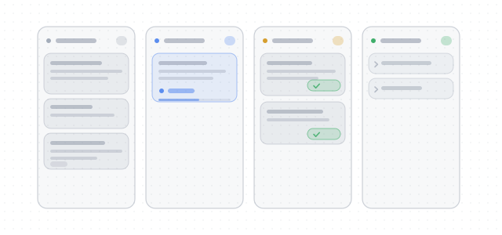

# 任务看板 · dsh-kanban-fx

仓库：[github.com/xianglifei/dsh-kanban-fx](https://github.com/xianglifei/dsh-kanban-fx) · 许可：[MIT](LICENSE)

DeepSeek Harness（DSH）Web 插件的任务看板：侧边栏一个入口，每个工作区的「…」菜单里还有一个
直接落到该工作区的快捷入口；**看板 / 列表**两种视图。
看板按四列 **待办 / 进行中 / 待审核 / 已完成** 看流程；列表是一张平铺表格，状态是行内字段，点表头排序。

先把想法、附件、所属工作区存成待办卡片；想开工时点卡片上的「执行」（或新建卡片时点「▶ 立即执行」），
插件会直接在那个工作区里建一个会话、把卡片内容作为首条消息投进去并立刻开跑，**不经过新建会话页**
（手写标题会作为首条消息的第一行，正文原样跟在后面；标题留空时只发正文）。
之后卡片状态完全跟着会话走：跑完进待审核，你点开进普通会话页看结果，在里面继续说话又回到进行中，
满意就在看板或列表上点「✓ 完成」；也可以直接在会话标题栏点「✓ 完成」——它会顺手把你看板带回这张卡片所在的工作区。
顶栏最右侧的齿轮里可以改「完成之后」：默认什么都不做；也可以写一条收尾提示词，点完成后先发进当前会话，
卡片以「收尾中」跑这一轮，正常结束自动进已完成（报错 / 中止回待审核）。



## 界面

点阵画布上四张浮起的圆角卡（每列一张），颜色全部走 `--dsw-alias-*` token。
标题右侧是**视图切换**（看板 / 列表）。视图是页面级选择，切换只换内容区，
默认看板；选过的视图记在浏览器本地，下次进来还是它。

右上角是**工作区切换器**（不是筛选器）：一次只显示一个工作区，没有「全部」，
切换成本和在侧边栏切工作区一样；进来时停在「上次看过的工作区」
（从工作区的「…」菜单进来，就是你点的那个）。
切换器前的「工作区」是字段名，12.5px、字重 560、二级文字色 —— 比下拉里的值大半级：
再小、再淡就贴着 30px 高的下拉框读成一条注脚了。
新建待办的「所属工作区」默认就是这个工作区，且为必填。

侧边栏里每个工作区行尾「…」菜单的第一项是**「打开任务看板」**，排在「重命名」「在 Finder 中显示」
前面：点一下就切到看板，并把工作区切换器落在**这个**工作区上，不用进去再切一次。
工作区行右键弹出的也是同一项；看板已经开着时点它只换筛选，不会重开页面。

顶栏没有刷新按钮：数据新鲜度全自动，只有读取失败时错误条上会出现「重试」。
一次读取看板本身也会让 Host 做一次状态校准（把「进行中」但会话其实已经停了的卡片落回待审核），
所以手动点与不点没有区别。新鲜度靠这四层保证：

- **变化推送**：Host 每次改卡片都通过 SSE 推一个 `rev`，页面收到就静默重读，正常是秒级；
- **兜底轮询**：15 秒一次静默重读；
- **回到前台**：窗口重新获得焦点、或标签页重新可见时各读一次；
- **心跳**：Host 每 25 秒推一帧 `beat`，页面 70 秒收不到任何一帧就重建订阅并补读一次，
  防止连接半死（例如订阅超过 8 条被 429 拒掉）之后页面一直停在旧数据。

「新建待办」保留两个入口，可以并行使用：

- **右上角**：面板工具栏最右侧的「+ 新建待办」；
- **内容末尾**：看板在待办列尾（下一张卡片会出现的位置），列表在表尾（排序后它只是入口，不再代表位置）。

窄屏（<700px）下右上角入口一直在；看板的待办列入口在切到待办状态时同样可用，列表的表尾入口一直在。
窄到 430px 以下，右上角的新建收成「+」，把宽度让给「看板 / 列表」两个标签。


> 这两张看板图拍于 0.1.x，顶栏还没有「看板 / 列表」视图切换；
> 0.3.1 的顶栏以本文的列表图为准：标题旁只有视图切换，没有刷新图标（看板图下次重拍时一起更新）。

看板的「已完成」列默认折成一行标题（约 32px 高），一屏能放下更多历史卡片；点任意一行才展开成完整卡片，
展开后标题右侧的小箭头可以再折回去。展开状态只留在当前面板里，刷新后全部回到折叠态。


深色下新建待办的侧栏：主按钮用 `label-primary` / `label-primary-foreground` 这对「墨 / 纸」token，
不会出现品牌色和底色撞在一起的黑底黑字：


看板窄屏（<700px）四列换成状态分段控件 + 单列（列表的窄屏规则见下文）：


标题旁那个灰色的 `fx-6` 就是卡片编号：草稿第一次自动保存后出现，点一下可复制，看板卡片上不显示（见下文「卡片编号」）。

## 列表视图


列表不按状态分组：状态只是每行一颗 pill（待办 / 进行中 / 待审核 / 已完成），
表头 sticky，点任意可排序表头排序。默认按状态升序 —— 流程顺序、待办在最上面；再点同一列反向。

| 列 | 内容 | 排序 |
|---|---|---|
| 状态 | 圆点 + 文案；待办中性、进行中 ink、待审核琥珀、已完成绿 | 按 待办 → 进行中 → 待审核 → 已完成 |
| 编号 | `fx-12` | 按数字 |
| 任务 | 标题一行；附件数、有报错、会话已归档跟在后面 | 按标题 |
| 用时 | 进行中实时计时；待审核 / 已完成上一次用时；待办是 `—` | 按时长 |
| 更新 | 今天 / 昨天 / 月日 + 时刻 | 按时间 |
| 操作 | ▶ 执行 / ✓ 完成 / ↩ 撤销；归档卡片才有 ↻ 重新执行 | 不可排 |

- 未在排序的列显示淡的双向箭头，当前列只亮一边；`aria-sort` 同步，键盘可以直接 Tab 到表头按钮。
- 「更新」读卡片已有的 `updatedAt`（turn 开始 / 结束、编辑、完成都会更新），不新增字段。
- 视图和排序都记在浏览器本地（`dsh-kanban-fx.view` / `dsh-kanban-fx.sort`）；默认看板 + 状态升序。
- 平铺后没有组头计数，表尾补一行 `共 N 张 · 待办 … · 进行中 … · 待审核 … · 已完成 …`。
- 已完成不再逐张折叠；按状态排序时它们自然在最后，想先看最近动过的就点「更新」。
- 表尾「＋ 新建待办」是第二条入口；排序后它不再代表「下一张卡的位置」，只是入口。
- 中等宽度（701–1080px）收起编号 / 用时 / 更新，只留状态 + 任务 + 操作；
  窄屏（<700px）只留任务 / 操作，状态变成标题前色点，进行中计时顶到操作列，表尾写明当前按哪列排序。

深色与窄屏：


> 列表这几张拍于 0.4.0，顶栏还没有最右侧的设置齿轮；0.5.0 的顶栏以本文「收尾中」看板图为准。

> 本页所有界面图（看板、列表、新建侧栏、设置页）都是真实 `client.js` 的 React 组件树 + CSS 在无头 Chrome 里渲染的自查图（假数据），
> 不是应用内截图；应用内以浅 / 深色 token 实际值为准。

## 设置

顶栏最右侧（「+ 新建待办」右边）有一颗齿轮。点进去是设置页：它只换内容区，返回后回到进入前的看板 / 列表和工作区，刷新页面也还是原来的视图。

设置页只有一块会写服务端的内容，其余是只读诊断信息和本机界面偏好。


### 完成之后

| 选项 | 点「完成」之后 |
|---|---|
| 什么都不做（默认） | 立即移入已完成，和 0.4.0 完全一样；toast 带撤销 |
| 发送一条收尾提示词，跑完自动完成 | 先把提示词作为一条普通用户消息发进这张卡片的会话；卡片进入进行中并显示「收尾中」；这一轮**正常结束**才自动移入已完成 |

- 提示词最多 4000 字符，前后空白会去掉；选这个模式时必须非空。
- 报错 / 被中止：卡片回到待审核，不会标成已完成。
- 会话已归档 / 找不到：不再尝试投递，直接完成并提示「收尾提示词未发送」。
- 只对点击后的下一轮生效。收尾期间又去会话里补话，自动完成会落在下一轮 `turn/end`（已知限制，v1 不区分哪条是收尾消息）。
- 「收尾中」不是第五种状态：它仍在进行中列，排序 / 筛选 / 计数都按进行中算，只是卡片脚部、列表状态和会话标题栏显示「收尾中」。
- 三个入口仍然都是「完成 = 回看板」：看板 / 列表直接换列；会话标题栏照旧跳回看板，只是落点是进行中（收尾中），提示改成「已发送收尾提示词，跑完自动完成」，且不提供撤销——消息已经发出去了。报错后卡片回待审核，可以再点一次完成重试。
- 撤销完成只撤销完成状态，不会撤回已经发出的消息。

设置停手 **600ms** 自动保存，页脚另有「保存」；保存走 `POST /kanban-fx/settings`，立刻生效，不重启插件、不断 SSE。提示词明文存在本机 `board.json`，不要放密钥。

### 高级

数据 / 限制 / 关于只读；界面偏好只写本机 localStorage：

- 数据：数据目录、`board.json` 路径（可复制）、存储版本、卡片总数；
- 限制：单张卡片正文字符上限、附件总大小上限（在 `cordis.patch.yml` 里改，重启生效）；
- 关于：插件版本、数据格式版本、接口前缀；
- 界面偏好（本机）：当前视图 / 列表排序，以及「恢复视图与排序默认值」——只清浏览器本地的两个 key，不动工作区记忆和卡片数据。

设置存进 `board.json` 而**不是** `cordis.patch.yml`：改配置会让插件重启，而这是一项应该即时生效的用户设置；部署级的目录 / 上限仍留在 `cordis.patch.yml`。

深色与窄屏：


## 安装

从 GitHub 安装（公开仓库，任意机器）：

```sh
dsh plugin --profile desktop add github:xianglifei/dsh-kanban-fx
```

本地目录安装（开发模式，链接到本仓库）：

```sh
dsh plugin --profile desktop add link:/Users/xianglifei/Code/Github/dsh-kanban-fx
```

或在 DSH 的 **Plugins → Add plugin** 里选择本目录。装好后侧边栏出现「任务看板」图标。

> **升级提示**：任务看板分 Host（`index.js`，负责设置 / 存储 / 状态机）和 Client（`client.js`，负责页面）两半。
> 从 0.4.x 升到 0.5.0 后，刷新页面只会换 Client；运行中的 Host 仍是旧代码，点保存会得到「接口不存在」。
> 在 DSH 里把「任务看板」插件禁用再启用（或重启 DSH）才会加载新的 Host；看板数据不受影响。
> 重载可能刷新面板，保存前先把设置页里的草稿复制出来，重载后粘贴回去再保存。

## 状态规则

| 状态 | 判定 |
|---|---|
| 待办 | 卡片还没有会话 |
| 进行中 | 会话里有未闭合的 turn（带本轮开始时间，用于计时） |
| 进行中（收尾中） | 点过完成，收尾提示词已投递，这一轮还没结束；仍按进行中计数与排序 |
| 待审核 | 会话的 turn 已闭合，且没有被手动标记完成 |
| 已完成 | 用户点完成；或 prompt 模式下收尾轮正常结束自动完成 |

- 任何一次 turn 结束（正常/报错/被中止）都进待审核；**收尾轮例外**：正常结束自动进已完成，
  报错 / 被中止回待审核。报错会在卡片上留一个「有报错」徽标。
- 「收尾中」不是第五种状态：`status` 仍是进行中，列、排序、筛选、计数都不变，只改可见文案。
- 已完成不是终点：用户在会话里继续说话 → 自动回进行中 → 跑完再回待审核。
- 看板的已完成卡片默认折叠成标题行，点标题展开详情 / 操作按钮；刷新后重新折叠。
- 列表不折叠：已完成是普通行，按状态排序时自然落在最后。
- 两个视图共享同一套状态规则；列表只是把四列摊成一张表，状态是行内字段。
- 本期不支持拖拽或手动改状态。

进行中列里的「收尾中」和顶栏最右侧的设置齿轮：


## 在会话页标记完成

从看板或列表「执行」出来的会话，标题栏（会话标题右边）会多出两样东西；普通新建的会话没有：

- **卡片状态**：`● 进行中` / `● 收尾中` / `● 待审核` / `● 已完成`，颜色和看板列头那颗点一致；「收尾中」用的是进行中的 ink，只是文案不同；
- **「✓ 完成」按钮**：只在待审核出现。普通模式下点一下把卡片标成已完成，并直接切回任务看板，
  任务看板会切到这张卡片所在的工作区，落地后弹一条「已把 fx-12 移到已完成 / 撤销」。
  prompt 模式下仍然切回看板，但卡片落在进行中（收尾中），提示改成「已发送收尾提示词，跑完自动完成」，
  不提供撤销（消息已经发出去了）。

约定是「圆点 = 状态，✓ = 动作」，所以进行中、收尾中和已完成不显示按钮——状态标已经说明为什么没有按钮，
比一颗点不了的灰按钮干净。状态完全跟着会话走：

| 会话里发生了什么 | 标题栏 |
|---|---|
| 这一轮还在跑 | `● 进行中`，没有按钮 |
| 收尾提示词在跑 | `● 收尾中`，没有按钮 |
| 这一轮跑完 | `● 待审核`，出现「✓ 完成」 |
| 收尾轮正常结束 | `● 已完成`，没有按钮 |
| 收尾轮报错 / 中止 | `● 待审核`，出现「✓ 完成」；报错时卡片带「有报错」 |
| 待审核时继续说话 | 当场回到 `● 进行中`，按钮消失；跑完再回待审核 |
| 点过完成之后再进来 | `● 已完成`，没有按钮 |
| 普通会话 / 卡片已删 / 会话已归档 | 什么都不显示 |


上面是浅色 / 深色两组自查渲染（假数据），每组三行分别是待审核、进行中、已完成；
这张图拍于 0.4.0，还没有「收尾中」这一态；它和进行中同色，只是文字变成「收尾中」。
状态标在窄标题栏下只留圆点，文字收成屏读文本。

## 自动保存

新建 / 编辑待办的侧栏默认开着自动保存，不用记着点「保存」：

| 时机 | 行为 |
|---|---|
| 停手 1.2 秒 | 把当前内容存一次（第一次会自动把草稿落成待办卡片） |
| 一直打字 | 每 8 秒兜底存一次 |
| 点侧栏外面 / 按 Esc / 点 ✕ | 关闭前再补存一次 |
| 点「保存」 | 立刻落库并关闭 |
| 点「▶ 立即执行」 | 先落库，再开跑 |

- 第一次自动保存后就固定在同一张卡片上更新，不会越写越多张。
- 附件只在第一次上传，后续保存只带引用，不会每 8 秒重传一遍。
- 补存失败（比如网络抖动）会留在侧栏里报错，不关闭、不丢内容；恢复后再关一次就存上了。
- 如果这张卡片在 Host 侧真的没了（被删掉 / 数据被换过），下一次自动保存会自动新建一张兜底，不会一直报「卡片不存在」。
- 侧栏底部一直显示状态：`自动保存已开启` / `有改动，稍后自动保存` / `自动保存中…` / `已自动保存 21:13`。

## 标题与首条消息

卡片标题可以留空。两种写法在执行时走不同的规则：

| 你写的 | 卡片标题 / 会话名 | 首条消息 |
|---|---|---|
| 手写标题 + 正文 | 手写标题 | `# 手写标题` + 空行 + 正文原样 |
| 手写标题，正文空 | 手写标题 | 标题本身（不加 `#`） |
| 标题留空 + 正文 | 正文第一个非空行（剥掉行首 `#` / 列表 / 引用记号，按句读或空格边界截到 42 字） | 正文原样，不加标题行 |
| 标题留空，只有附件 | 附件名（只有一个附件时；多个则「未命名事项」） | 只有附件 |
| 手写标题与正文首行是同一句 | 手写标题 | 正文原样（不重复发标题） |

- 只有**你亲手写的标题**会进消息；自动派生出来的标题只做卡片标题和会话名，不会在消息里再出现一遍，
  所以正文不会被重复发送。
- 新建 / 编辑侧栏里，派生标题不回填到标题框：标题框留空并显示「标题未填写」，下面实时预览「会话名：……」；
  想换个名字直接写，写了就以你写的为准（清空又回到自动派生）。
- 旧数据（v1）里 `title` 等于老派生结果的卡片，加载时会认成「当年没手写」，迁成空串继续自动派生；
  其余保留为手写标题。

## 卡片编号

每张卡片落库时会拿到一个短编号，对用户显示为 `fx-1`、`fx-2`……（数据里只存数字 `seq`，`fx-` 是显示前缀）。

- 出现在**新建 / 编辑待办的侧栏标题旁**（灰色小字，跟在新待办标题后面）和**列表的「编号」列**；看板卡片上不显示；
- 草稿在第一次自动保存（或点「保存」）后才拿到编号，拿到后标题旁会即时出现；
- 点一下编号即可复制，以后在会话里可以直接说「处理 fx-12」；
- **只增不复用**：删掉 `fx-3` 之后，下一张新卡仍是 `fx-4`，空号不会回收；
- 旧数据第一次加载时按创建时间补号（1、2、3……），之后保持不变；编号存在 `board.json` 里，重启不重排。

## 数据

- 看板数据：`$DSH_HOME/dsh-kanban-fx/board.json`（默认 `~/.dsh/dsh-kanban-fx/board.json`）。
  卸载插件后数据仍留在磁盘上。
- 存储版本 `version: 2`：`title` 从 v2 起只存**用户手写的标题**（空串 = 自动取正文首行）；
  加载 v1 数据时会按老派生规则把自动标题迁成空串。看板接口里的卡片另外带 `titleInput`（手写原文）与
  `titleDerived`（是否自动），`title` 是 Host 实时派生的展示标题。
- 用户设置：`settings.completion = { mode: 'none' | 'prompt', prompt: string }`，默认 `none`；
  `prompt` 最多 4000 字符，明文存在 `board.json`。这是**可选新增字段**，旧文件没有就按默认读，
  所以存储版本仍保持 2，不触发标题迁移。
- 收尾标记：卡片上的 `finishingSince` 是收尾轮开始时间，非空即「收尾中」；`turn/end` 正常结束才写 `doneAt`。
- 接口里的 `advanced`（版本、数据目录、上限）是只读运行信息，不落库；本机界面偏好仍只存 localStorage。
- 卡片编号：卡片上有 `seq`（数字），看板文件顶层有 `nextSeq`（下一个可用号），两者一起保证编号不重号、不复用。
- 列表的「更新」列读卡片已有的 `updatedAt`（turn 开始 / 结束、编辑、完成都会更新），不新增存储字段。
- 附件：走 DSH 自己的附件服务（和新建会话输入框同一套落盘），卡片里只存引用。
- 单张卡片附件总量上限 24 MB，单张卡片正文上限 20 万字符（可在 `cordis.patch.yml` 里改）。

## Host 接口

所有接口都在 `/kanban-fx` 前缀下，非 `/api` 路由，插件自己做了 DSH 的 Host/Origin 与登录校验。

| 方法与路径 | 用途 |
|---|---|
| `GET /kanban-fx/board` | 看板快照（卡片、工作区、默认工作区 = 校验过的 `lastWorkspaceId`、`rev`、`serverNow`，以及 `settings` / `advanced`） |
| `GET /kanban-fx/events` | SSE：有变化推 `rev`（25 秒没变化也会推 `beat` 心跳）；客户端收到 `rev` 后自己重读 `/board` |
| `GET /kanban-fx/attachment?id=` | 卡片附件的原图 / 原文件 |
| `GET /kanban-fx/card?sessionId=` | 会话对应的卡片（给会话页标题栏用）；不是看板卡片返回 `card: null`；卡片附带 `completionMode` 供 tooltip 用 |
| `POST /kanban-fx/card` | `{action: create \| update \| delete \| run \| done \| undone, ...}`；`done` 传 `id` 或 `sessionId` 都可以 |
| `POST /kanban-fx/settings` | `{settings:{completion:{mode:'none'\|'prompt', prompt}}}`；整体替换、严格校验，返回完整看板载荷 |

完成接口的 `done` 响应多两个字段：`completionResult`（`done` / `sent` / `fallback-done`）和
`completionWarning`（`session-archived` / `session-missing`，仅 fallback）。`sent` 表示卡片现在在收尾中。

## 执行链路

1. `ctx.sessionController.create({ sessionId, workspaceId })` 建会话（自动挂到该工作区，出现在侧边栏）。
2. 会话标题改成卡片的展示标题（手写标题优先，没写就取正文首行），所以侧边栏看到的是你的任务名。
3. 首条消息的文本：手写标题作 `# 标题` 第一行 + 空行 + 正文原样（正文首行已经是同一句时省略标题行，
   没写标题时只发正文）；图片/文件 → `ctx.attachments.saveImage/saveFile` 的引用 → 原生 `image`/`file` 块。
4. `agent.followup({ id, role:'user', content, source:{kind:'user'} })` 立刻开跑。
5. 监听 `session/event` 的 `turn/start` / `turn/end` 维护状态与计时。

## 完成链路

1. 看板 / 列表 / 会话标题栏点完成 → `POST /kanban-fx/card {action:'done'}`。
2. mode = none：`doneAt = now`，返回 `completionResult: 'done'`。
3. mode = prompt：校验 review → `resolveAgent` → 写 `runningSince` / `finishingSince` →
   `agent.followup({ id, role:'user', content:[{type:'text', text: prompt}], source:{kind:'user'} })`；
   返回 `'sent'`。会话已归档 / 找不到 → 直接 `doneAt`，返回 `'fallback-done'` + warning。
4. `turn/end` 正常 → `doneAt = event.time`，清 finishing；`error` / `aborted` → 清 finishing，留在待审核。
5. `reconcile` 每 30 秒兜底：收尾中超过 10 秒且 agent 不在 running → 回待审核并提示重试；
   Host 重启后同样不猜成功。

## 会话被归档 / 删掉

- 卡片 / 列表行上会出现「会话已归档」徽标，点卡片只给提示，不再跳转。
- 卡片上会多一个「▶ 重新执行」，列表行尾部会多一个 ↻：它们会在同一个工作区开一个新会话重跑（旧会话保持原样）。
- 这一步是自动兜底：每次读取看板时都会核对归档集合。
- prompt 模式下对已归档 / 找不到的会话点完成：不再尝试投递，直接标完成并提示「收尾提示词未发送」，不会 500。

## 明确不做（v1）

拖拽排序 / 跨列手动移动 / 自定义列、在看板或列表里直接对话、子任务与截止日期、附件在线预览、
卡片多会话历史（会话页只多了标题栏的完成按钮，其余不做改造）。
列表这版也不做：列宽自定义、多选、搜索、「隐藏已完成」开关（靠状态排序把已完成压到底部）、
新建后的自动滚动定位；「全部工作区」仍不在范围内。
设置页也不做：每张卡片 / 每个工作区单独的收尾词、提示词模板变量、提示词库、完成后自动归档 / 通知、
导出 / 导入 / 清空看板、修改数据目录或正文字符 / 附件上限。

## 开发

- `index.js`：Host 半（存储、HTTP、执行、完成两段式、状态机）。
- `client.js`：Client 半（侧边栏入口、看板面板、列表表格、新建/详情抽屉、设置页、会话标题栏的状态与完成按钮）。
- 推送约定：**每次 push 前都要更新 `README.md` 与 `CHANGELOG.md`**，细则见 [AGENTS.md](AGENTS.md)；
  版本号与 CHANGELOG 顶部保持一致。
- 只看 node 内置模块与 `ctx` 上的服务，不 import 任何 `@deepseek-ai/*` 包，所以不需要构建步骤。
- 自查脚本（在 `/tmp`，不进仓库）：Host 半用假 ctx 跑真实路由与状态机（含设置 / 收尾两段式、
  报错 / 中止 / 归档兜底 / reconcile 超时）；Client 半用真实 React + JSDOM 挂载 Panel 与 Header，
  跑齿轮、设置页、radio / textarea、保存、列表「收尾中」和标题栏 tooltip / 跳转。
  历史界面截图由同一套组件树 + CSS 在无头 Chrome 里渲染（假数据）。
- 视觉沿用「点阵画布 + 浮起圆角卡」：卡片 14px 圆角、发丝边、一层柔和阴影，颜色全走 `--dsw-alias-*` token；
  设置页复用同一套浮起卡；看板窄屏（<700px）四列换成状态分段控件 + 单列；列表窄屏收成任务 / 操作两列。

## 许可

[MIT](LICENSE)。欢迎 fork、改、提 PR；提 PR 前先看 [CHANGELOG](CHANGELOG.md) 的写法（每个版本一小段，写清「改了什么、为什么」）。
