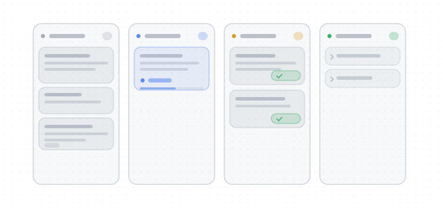

# dsh-kanban-fx · Details

[中文详细说明](DETAIL.zh.md) · [README](../README.md)

A kanban board for the DeepSeek Harness (DSH) web app. Turn an idea into a card, press **Run**, and the plugin
creates a session in the card's workspace and sends the card content as the first message — no trip through the
"new session" page. Card status follows the session, so the board is always the source of truth.



## Install

```sh
dsh plugin --profile desktop add github:xianglifei/dsh-kanban-fx
```

Requires DSH `^0.2.2-rc.1`. After install, a **Task board** entry appears in the sidebar. You can also open it
for a specific workspace from that workspace's `…` menu.

## Status

| Status | When |
|---|---|
| To do | The card has no session yet |
| Running | The session has an open turn (the card shows a live timer) |
| Review | The turn ended and waits for your sign-off |
| Done | You marked it done, or a finishing prompt ran successfully |
| Running (finishing) | A finishing prompt was delivered and its turn has not ended; still counted as running |
| Running (waiting for you) | The agent asked a question or awaits an approval; the turn is open, the ball is in your court. Still counted as running |

Status follows the session: talking in the session moves the card back to Running; the turn ending moves it to
Review again. Done is not final. Drag-and-drop and manual status changes are not supported in v1.

`ask_user_question` (and an approval prompt) suspends the turn without ending it, so the card stays in Running.
Instead of moving it to Review, the card is marked **waiting for you**: an amber dot, `0:40 waiting` (how long
it has waited, not the run time), moved to the top of the Running column, and the column count turns amber.
Answer in the session and the card continues in place; the wait is subtracted from the card's "took …" time.
It is a label on Running, not a fifth status, and it never enters Review until the turn actually ends.

## Views

- **Board**: four columns. The Done column is collapsed to one title row per card by default; click to expand.
- **Card footer** never breaks words. A running card keeps "running" / "wrapping up" on one line and drops the
  right-aligned "since 11/15 14:30" once its column is narrow (under 260px in English, 230px in Chinese).
  A waiting card swaps the pulsing ink dot for a calm amber dot and shows the wait timer instead: `00:40 waiting`.
  Review / Done shrink to "took 3m" instead of "took 3m 20s" and "done 11/14" instead of "done 11/14 09:20"
  under 190px; when even that does not fit next to the buttons, the footer wraps as a whole and the buttons stay
  right-aligned (the card gets ~30px taller, no word is split).
- **List**: a flat sortable table, status shown as an inline pill (a waiting card reads "Waiting" and its
  duration cell shows how long it has waited). Medium widths drop the number / duration /
  updated columns; narrow screens keep only Task and Actions.
- One workspace at a time. The workspace switcher is not a filter — there is no "All workspaces".
- View and sort order are stored in browser localStorage.

## Finish behavior

Settings (gear at the top right) offers two modes:

- **Do nothing** (default): pressing Done moves the card to Done immediately.
- **Send a finishing prompt**: Done first sends the prompt as a normal user message to the card's session; the
  card shows "Finishing" and only moves to Done if that turn ends normally. Errors / aborts return it to Review.
  Max 4,000 characters, required when this mode is selected, stored in plain text locally.

## Isolated worktree (optional, experimental)

Cards that run in the same repository share one checkout otherwise. The board does **not** implement Git
worktrees itself: it calls DSH's own worktree service.

1. In DSH, enable **“Change requests & worktrees”** under Settings → Plugins and restart. The board detects
   that service; without it the worktree switch stays disabled and points you there.
2. In the board, open Settings (gear) → **Experimental** → “Offer an isolated worktree on cards”.
3. On a new or edited card, tick **“Run in an isolated worktree”** (off by default).

On the card's first run the plugin creates a branch `fx-<number>-<title-slug>` and a checkout under
`<repo>/.agents/worktrees/`, switches the session directory there, and then sends the card content. The source
checkout is untouched; uncommitted changes are not copied. The card shows a branch chip (branch icon + branch
name), “preparing worktree” while it is being created, and returns to To do with the reason if creation fails (a
retry uses a new branch name). Once a card is done, the same chip also reports whether that branch was merged
(see the upgrade note below). A worktree is only created before the first message is delivered; a card that already ran in the
project directory is never moved into one later. Re-running an archived card re-enters the same checkout. Archiving the session lets DSH reclaim a
clean, unreferenced checkout but keeps the branch; deleting a card never deletes a branch.

Limitations come from DSH: local commits only (no fetch, no submodule init, no uncommitted files), read-only
sessions and repositories that are themselves linked worktrees are unsupported, large repositories take a while,
and this version has no cancel. Works with DSH `0.2.2-rc.3`.

## Data

- Board file: `$DSH_HOME/dsh-kanban-fx/board.json` (default `~/.dsh/dsh-kanban-fx/board.json`). Uninstalling the
  plugin leaves it on disk.
- Card body limit 200,000 characters; attachments 24 MB per card (change in `cordis.patch.yml`, restart to apply).
- Card IDs (`fx-1`, `fx-2`, …) are click-to-copy and never reused.

## Upgrading

Both halves change in 0.6.0 (Host feature detection and the worktree step before delivery; Client settings,
editor option, and card chip). Reload the plugin or restart DSH, then refresh the page. Enable the DSH
“Change requests & worktrees” bundle to use the feature; without it the option is only greyed out.
`board.json` gains optional fields (`settings.worktree`, `card.worktree`, `preparingSince`) and keeps storage
version 2.

0.6.1 touched only the client (card footer layout in the Running column) — reload the page, no Host restart.

0.7.0 adds "waiting for you" on both halves (Host listens to `ask_user_question` / approval session events,
client renders the footer, ordering, column count, list pill and session header). Reload the plugin or restart
DSH, then refresh the page. No new stored fields: `awaiting*` lives in memory only and storage stays at version 2.

0.7.1 is client-only: the session header gains a worktree badge (branch icon + branch name) for cards that run in
an isolated worktree, so the session itself says where it works; hovering shows the branch, the checkout path and
the reminder to merge back. `GET /card` already carries `worktree.branch` / `worktree.path`, so nothing changes on
the Host, in the API or in `board.json` — a page refresh is enough.

0.8.0 adds merge state to the Done column on both halves: the Host observes branches with read-only Git (one
`for-each-ref` per repository at most every 60 seconds, `--contains` plus `rev-list --count` per card, no fetch, no
writes, 3-second timeout) and snapshots the result in `card.worktree.merge`; the client renders unmerged / merged /
merged-and-deleted / no-commits / unmerged-and-deleted on folded Done rows, counts unmerged branches in the column
header, and asks before marking an unmerged card done. A new Experimental setting turns the probing off (cards then
show only the branch name). `GET /board` cards gain `worktree.merge` / `worktree.probe`, `GET /card` gains
`mergeState`, and `POST /settings` accepts `worktree.mergeState` alongside `offer`. Reload the plugin or restart
DSH, then refresh; `board.json` only gains an optional field and storage stays at version 2. Squash and rebase
merges cannot be detected, so the copy says “not detected” rather than “not merged”. 

0.9.0 builds on that: the probe also runs a read-only `git status --porcelain` inside the checkout, so uncommitted
files show up as “uncommitted” instead of “no commits” (`merge.dirty` / `merge.dirtyCount`); the branch chip gets a
copy button for the merge or cleanup command; the completion dialog gained “copy command” and “let the conversation
merge” (`POST /card {action:'merge'}` sends the card's conversation a message with the repo root, branch, checkout
and steps — the model does the Git writes under that session's sandbox, and the card returns to Running for that
turn). The settings page now spells out the reminder under the worktree switch. Both halves change: reload the
plugin or restart DSH, then refresh; storage stays at version 2.

## Reference

Interface details, autosave, title derivation, card numbering, storage schema, Host endpoints, and the run /
finish flows are documented in [DETAIL.zh.md](DETAIL.zh.md) (Chinese).

## License

[MIT](../LICENSE).
