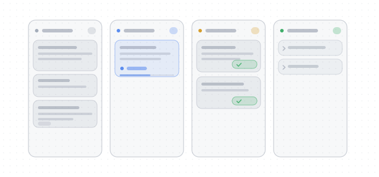

# dsh-kanban-fx · Details

[中文详细说明](DETAIL.zh.md) · [README](../README.md)

A kanban board for the DeepSeek Harness (DSH) web app. Turn an idea into a card, press **Run**, and the plugin
creates a session in the card's workspace and sends the card content as the first message — no trip through the
"new session" page. Card status follows the session, so the board is always the source of truth.



## Install

```sh
dsh plugin --profile desktop add github:xianglifei/dsh-kanban-fx
```

Requires DSH `^0.2.2-rc.1`. After install, a **Task board** entry appears in the sidebar. You can also open it
for a specific workspace from that workspace's `…` menu.

## Status

| Status | When |
|---|---|
| To do | The card has no session yet |
| Running | The session has an open turn (the card shows a live timer) |
| Review | The turn ended and waits for your sign-off |
| Done | You marked it done, or a finishing prompt ran successfully |
| Running (finishing) | A finishing prompt was delivered and its turn has not ended; still counted as running |

Status follows the session: talking in the session moves the card back to Running; the turn ending moves it to
Review again. Done is not final. Drag-and-drop and manual status changes are not supported in v1.

## Views

- **Board**: four columns. The Done column is collapsed to one title row per card by default; click to expand.
- **List**: a flat sortable table, status shown as an inline pill. Medium widths drop the number / duration /
  updated columns; narrow screens keep only Task and Actions.
- One workspace at a time. The workspace switcher is not a filter — there is no "All workspaces".
- View and sort order are stored in browser localStorage.

## Finish behavior

Settings (gear at the top right) offers two modes:

- **Do nothing** (default): pressing Done moves the card to Done immediately.
- **Send a finishing prompt**: Done first sends the prompt as a normal user message to the card's session; the
  card shows "Finishing" and only moves to Done if that turn ends normally. Errors / aborts return it to Review.
  Max 4,000 characters, required when this mode is selected, stored in plain text locally.

## Data

- Board file: `$DSH_HOME/dsh-kanban-fx/board.json` (default `~/.dsh/dsh-kanban-fx/board.json`). Uninstalling the
  plugin leaves it on disk.
- Card body limit 200,000 characters; attachments 24 MB per card (change in `cordis.patch.yml`, restart to apply).
- Card IDs (`fx-1`, `fx-2`, …) are click-to-copy and never reused.

## Reference

Interface details, autosave, title derivation, card numbering, storage schema, Host endpoints, and the run /
finish flows are documented in [DETAIL.zh.md](DETAIL.zh.md) (Chinese).

## License

[MIT](../LICENSE).
